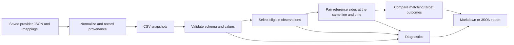

# Odds Analysis

Turn player-prop market snapshots into an explainable comparison report. Generate and replay a simulated market offline, with no accounts, API keys, browser setup, or runtime dependencies.

This project grew out of a Selenium/Tkinter sports-odds prototype. The remake focuses on validated inputs, reproducible analysis, and testable mathematics. [Read the redesign notes](docs/design.md).

## Try the demo

Requires Python 3.11 or newer. From the project directory:

```sh
python3 -m venv .venv
source .venv/bin/activate
python -m pip install -e .
odds-analysis demo
```

The demo creates eight snapshots and checks 24 expected comparisons plus eight diagnostic expectations. Open `reports/demo/replay/summary.md` for the timeline, expected versus observed results, and links to each market report. [Preview the default replay report](examples/replay-report.md).

The scenarios show similar book prices, a lagging target price, stale references, reference recovery, different thresholds, missing sides, disagreement, and target convergence. Seeded price changes and a fixed simulation clock make the result reproducible. All players and quotes are invented; these checks demonstrate software behavior, not predictive accuracy or returns.

On Windows, activate with `.venv\Scripts\Activate.ps1` in PowerShell. Installation may download the build tool; running the installed package requires no network access. To try it directly from source without installation:

```sh
PYTHONPATH=src python3 -m odds_analysis demo
```

Each run requires a new output directory. For another seed, or to generate snapshots and replay them separately:

```sh
odds-analysis demo --seed 7 --output reports/demo-seed-7
odds-analysis simulate --seed 42 --output reports/scenarios
odds-analysis replay reports/scenarios
```

See the [simulation and replay guide](docs/simulation.md) for the bundle format, checks, and exit codes. The installed demo works from any directory.

## Inspect a single snapshot

```sh
odds-analysis examples/synthetic_quotes.csv --as-of 2030-01-15T12:05:00Z
```

The synthetic fixture contains 19 rows, including intentionally bad data. It produces four target comparisons, one qualifying positive gap, and ten diagnostics. The fixed report time makes the result reproducible regardless of today's date.

| Player | Target quote | Reference probability | Target implied probability | Gap | Result |
| --- | --- | ---: | ---: | ---: | --- |
| Alex Example | Over 24.5 at +120 | 50.00% | 45.45% | +4.55 pp | `gap` |
| Alex Example | Under 24.5 at -120 | 50.00% | 54.55% | -4.55 pp | `within_threshold` |
| Blair Example | Over 45.5 at -110 | — | 52.38% | — | `different_line` |
| Drew Example | Over 52.5 at +120 | — | 45.45% | — | `no_reference` |

Read the [complete example report](examples/report.md) to see the exclusions.

## What it does

- Converts American odds to probabilities and back, removes margin proportionally from paired outcomes, and provides conditional expected-return math.
- Validates CSV records, normalizes timestamps to UTC, and distinguishes missing values from zero.
- Selects eligible pregame snapshots and handles duplicates, conflicting prices, stale observations, and incomplete reference markets explicitly.
- Compares identical event/player/market/line/side outcomes across configured reference books and a target book.
- Combines several reference books with an equal-book median and displays each contribution, exclusions, and disagreement.
- Exports deterministic Markdown or JSON, including quote timestamps and diagnostic codes in JSON.
- Imports saved provider JSON with explicit identity mappings and an audit manifest, preserving source update times.
- Generates seeded scenario bundles and replays each snapshot against authored comparison and diagnostic expectations.



## Use your own snapshots

```sh
odds-analysis private/quotes.csv \
  --reference-book Reference \
  --target-book Target \
  --as-of 2030-01-15T12:05:00Z \
  --max-age-minutes 15 \
  --min-gap-pp 2 \
  --format json \
  --output reports/comparison.json
```

Book names are exact after whitespace normalization. The CSV adapter accepts exactly these columns, in any order:

```csv
event_id,event_start,observed_at,sport,player,market,line,side,book,american_odds
demo-001,2030-01-15T20:00:00Z,2030-01-15T12:00:00Z,nba,Alex Example,player_points,24.5,over,Reference,-110
```

See the [schema and selection rules](docs/schema.md) before importing data. Keep local inputs under `private/` and generated reports under `reports/`; both are ignored by Git.

The original project's CSVs intentionally do not match this schema. They lack the individual reference-side snapshots needed to reconstruct an exact paired market reliably. They are not bundled or silently converted.

## Import a saved provider snapshot

Version 0.2 adds a read-only importer for saved The Odds API v4 event-odds JSON. The included data is synthetic; no API key or live request is needed.

```sh
odds-analysis import-snapshot examples/saved_event_odds.json \
  --mapping examples/snapshot_mapping.json \
  --captured-at 2030-01-15T12:05:00Z \
  --odds-format american \
  --output reports/imported.csv

odds-analysis reports/imported.csv --as-of 2030-01-15T12:05:00Z
```

This imports eight quotes and produces four comparisons: a qualifying gap, a matched quote below the threshold, and two different-line comparisons. [View the imported demo report](examples/imported-report.md).

Each import also writes `reports/imported.csv.manifest.json` with source/mapping hashes, capture time, source JSON locations, and diagnostics. Price freshness uses each market's source update time, never the time the file was imported. Event, player, sport, book, and market aliases are supplied explicitly in the mapping file.

Imports stop on diagnostics by default; `--allow-partial` explicitly exports accepted records with a complete diagnostic manifest. Existing outputs are never overwritten. See the [snapshot import guide](docs/snapshot-import.md) for the format, timestamp rules, and limitations.

## How the comparison works

For positive American odds `a`, the implied probability is `100 / (a + 100)`. For negative odds it is `abs(a) / (abs(a) + 100)`.

For a complete reference pair at the same threshold and observation time:

```text
reference_over_p  = implied_over_p  / (implied_over_p + implied_under_p)
reference_under_p = implied_under_p / (implied_over_p + implied_under_p)
gap_pp = 100 × (reference_p_for_side − target_implied_p)
```

For example, a -110/-110 reference pair becomes 50%/50% after proportional margin removal. A +120 target price implies 45.45%, producing a +4.55 percentage-point gap against that reference. The default flag threshold is +2 percentage points. A nonpositive gap never receives a `gap` flag.

With one reference book, this is the complete calculation. With several books, each book's complete pair is normalized separately, and the median of their probabilities becomes the reference estimate. See [the consensus method](docs/consensus.md) for the exact rules.

Reference probabilities are a modeling assumption about a market, not observed truth. A discrepancy between different thresholds is shown as `different_line`, with no probability gap. The tool does not place wagers, predict player performance, establish profitability, or implement a complete arbitrage strategy.

The current version supports pregame, positive half-integer player-prop thresholds. Integer thresholds are rejected because push probabilities are not modeled. Neither individual-book probabilities nor a multi-book consensus constitute a calibrated outcome model. Curve fitting and live read-only adapters are future work.

## Compare several reference books

Version 0.3 accepts repeated `--reference-book` options:

```sh
odds-analysis examples/consensus_quotes.csv \
  --as-of 2030-01-15T12:05:00Z \
  --reference-book 'Reference A' \
  --reference-book 'Reference B' \
  --reference-book 'Reference C' \
  --min-reference-books 2 \
  --max-disagreement-pp 10
```

The 28-row synthetic example produces five comparisons: two qualifying gaps, one matched quote below the flag threshold, one suppressed for disagreement, and one suppressed for too few usable references. [View the consensus report](examples/consensus-report.md), including each book's prices, probability, update time, and exclusion reasons.

Every book gets one contribution from its latest eligible snapshot at the target threshold, which must contain a complete pair. The default minimum is two usable books when several are configured, or one for a single reference. A probability range above the configurable 10-percentage-point limit suppresses the gap; the median and evidence remain visible. These controls are transparent demonstration policies, not empirically calibrated reliability thresholds.

Use `--format json` for unrounded probabilities and structured provenance. Analysis JSON now declares `schema_version: 2`; the original single-book CLI and `reference_book=` Python argument remain supported. The [consensus guide](docs/consensus.md) explains exclusions, even-count medians, and the limits of agreement.

## Develop and test

```sh
python -m unittest discover -s tests -v
python -m odds_analysis examples/synthetic_quotes.csv --as-of 2030-01-15T12:05:00Z --output reports/demo.md
```

Tests cover mathematical results, invalid inputs, identity matching, timestamp pairing, conflict handling, age boundaries, missing data, deterministic output, CLI failures, and synthetic examples. Import tests cover provider structure, scoped aliases, source timestamps, partial imports, audit manifests, and input/output preservation. Consensus tests cover medians, complementary outcomes, unique book votes, quorum, disagreement boundaries, exclusions, and provenance. Replay tests check independent expectations, changed or missing quotes, frame isolation, deterministic seeds, bundle paths, malformed inputs, and output preservation. [GitHub Actions](https://github.com/samuelfrey98/odds-analysis/actions) runs the suite and installed CLI demos on Python 3.11–3.14, including the self-contained demo outside the checkout.

The runtime uses only Python's standard library. Packaging follows the [Python Packaging User Guide](https://packaging.python.org/en/latest/guides/writing-pyproject-toml/).

## Project layout

```text
src/odds_analysis/
    adapters/csv_input.py   Strict, read-only CSV adapter
    adapters/odds_api.py    Saved provider JSON normalization
    models.py              Validated quote records and diagnostics
    odds.py                Probability, devig, and conditional return math
    comparison.py          Snapshot selection and market comparison
    reporting.py           Markdown and JSON output
    cli.py                 Command-line entry point
    import_cli.py          CSV export and import manifest
    simulation.py          Seeded, scripted snapshot generation
    replay.py              Snapshot replay and expected-behavior reports
    demo_cli.py            Offline demo, simulate, and replay commands
tests/                     Standard-library unittest suite
examples/                  Synthetic fixture and generated report
docs/                      Schema, design decisions, and project origins
```
