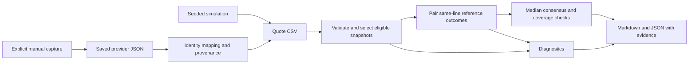

# Odds Analysis

[](https://github.com/samuelfrey98/odds-analysis/actions/workflows/tests.yml)

**Explainable player-prop market comparisons, from a reproducible offline demo to a bounded live capture.** Python 3.11–3.14 · standard-library runtime · [MIT license](LICENSE).

Sportsbook snapshots can disagree in price, threshold, or update time. This toolkit validates those observations, compares equivalent outcomes, and explains when a comparison is unsupported. Its reference estimate is the median of each book’s separately normalized probabilities.

The project remakes an earlier Selenium/Tkinter prototype as a small Python package with explicit inputs, reproducible reports, and 125 automated tests. The original private source and account files are excluded. [Read the redesign story](docs/design.md).

## Run the demo

Clone the repository and install into a virtual environment:

```sh
git clone https://github.com/samuelfrey98/odds-analysis.git
cd odds-analysis
python3 -m venv .venv
source .venv/bin/activate
python -m pip install .
odds-analysis demo
```

On Windows, activate with `.venv\Scripts\Activate.ps1` in PowerShell. Installation may download build tooling. The installed demo works from any directory and uses no API key, network, or current-clock data.

Expected output:

```text
PASS: 8 frames; 24/24 comparison checks; 8/8 diagnostic checks.
  0: normal: PASS
  1: target_lag: PASS
  2: stale_references: PASS
  3: reference_recovery: PASS
  4: line_mismatch: PASS
  5: missing_sides: PASS
  6: reference_disagreement: PASS
  7: target_converges: PASS
Report: reports/demo/replay/summary.md
```

Open that report for the timeline, expected versus observed comparisons, and links to each detailed market report. [Preview the checked-in replay](examples/replay-report.md).

The invented market moves through a lagging target price, stale references, recovery, different thresholds, incomplete pairs, disagreement, and convergence. Passing checks establish the authored software behavior; they do not measure prediction accuracy or profit.

Every demo output directory must be new. Generate another run or replay its saved inputs:

```sh
odds-analysis simulate --seed 7 --output reports/scenarios
odds-analysis replay reports/scenarios
```

To run from source without installation, use `PYTHONPATH=src python3 -m odds_analysis demo` on macOS/Linux. See the [simulation guide](docs/simulation.md) for seeds, bundle contents, and exit codes.

## What a report explains

Each reference book needs a complete Over/Under pair at the target threshold and one shared source timestamp. The analyzer removes each pair’s margin proportionally before combining book probabilities. Prices from different thresholds stay distinct.

For example, a -110/-110 reference becomes 50%/50% after normalization. A +120 target price implies 45.45%, leaving a +4.55 percentage-point gap. The default flag threshold is a positive gap of at least two percentage points.

| Situation | Report behavior |
| --- | --- |
| Enough same-line references agree | Compare the median reference probability with the target price |
| Fewer than the required references match | Show coverage and suppress the gap |
| References exceed the disagreement limit | Show the median and evidence, but suppress the gap |
| Thresholds differ | Show the lines without inferring a probability across them |
| Observations are stale, future, conflicting, or incomplete | Exclude unsupported observations and explain why |

With several references, the defaults require two usable books and suppress gaps above a ten-percentage-point probability range. These are demonstration policies, not calibrated reliability thresholds. Every report includes the contributing books, source times, exclusions, and diagnostics. [See the consensus method](docs/consensus.md).

Try the smaller, deliberately imperfect CSV example:

```sh
odds-analysis examples/synthetic_quotes.csv --as-of 2030-01-15T12:05:00Z
```

[View its report](examples/report.md), or [the multi-book example](examples/consensus-report.md). Inputs and report times are fixed so these examples remain reproducible.

## Architecture



| Layer | Responsibility |
| --- | --- |
| Adapters and models | Parse external data, validate values, preserve source timestamps |
| Odds math | Convert prices, remove paired-side margin, calculate conditional returns |
| Comparison | Select snapshots, pair outcomes, enforce coverage and disagreement policies |
| Simulation and replay | Generate scripted inputs and check independent expectations |
| Reporting and CLI | Export deterministic results and perform explicitly requested file/network operations |

Separating these layers makes the math and data policies testable without browsers or a provider account. [Design decisions and future work](docs/design.md).

## Commands and guides

| Command | Purpose | Guide |
| --- | --- | --- |
| `demo` | Generate and replay all eight synthetic scenarios | [Simulation](docs/simulation.md) |
| `simulate` / `replay` | Separate input generation from replay | [Simulation](docs/simulation.md) |
| `odds-analysis INPUT.csv --as-of TIME` | Analyze a local quote snapshot | [CSV schema](docs/schema.md) |
| `import-snapshot` | Normalize saved event-odds JSON using explicit aliases | [Snapshot import](docs/snapshot-import.md) |
| `capture` | Manually fetch and analyze one upcoming NBA player-points market | [Live capture](docs/live-capture.md) |

Use `--help` on any command. Local analysis supports Markdown or JSON output. Save your own inputs under `private/` and generated reports under `reports/`; both are Git-ignored. The bundled examples are synthetic.

### Optional live capture

Only `capture` reads `ODDS_API_KEY` or makes provider requests. It checks the event list and quota, then makes at most one odds request for one NBA event, `player_points`, and the US region. Quota metadata is saved, and failed requests are never automatically retried.

On macOS/Linux, run these commands separately. After the first command, enter the key at the hidden input and press Enter:

```sh
read -r -s ODDS_API_KEY
export ODDS_API_KEY
odds-analysis capture
unset ODDS_API_KEY
```

The default target is `fanduel`; reference keys are `draftkings`, `betmgm`, and `betrivers`. The private bundle contains the response, exact-name mapping, normalized quotes, provenance, quota audit, and reports. Source update times determine freshness. [Read the capture guide](docs/live-capture.md) for account requirements, request cost, limitations, and failure behavior.

A manual live acceptance check on 2026-10-28 imported 265 quotes and produced 22 comparisons: 14 within threshold and eight with insufficient same-line references. No qualifying gaps were found. Replaying the saved files reproduced the reports exactly. Real responses remain private and are excluded from the repository.

## Scope and limitations

This toolkit supports pregame player props with positive half-integer thresholds. It does not model integer-line pushes, fit player-performance distributions, place wagers, or track settlement and returns. A book consensus is a comparison assumption rather than observed truth; a flagged discrepancy does not establish executable arbitrage or profitability. Wider data collection and outcome evaluation require separate design and validation.

## Develop and test

After installation, run:

```sh
python -m unittest discover -s tests -v
```

The 125 tests cover math, malformed inputs, identity and timestamp matching, stale/conflicting/missing data, reference medians and exclusions, import provenance, replay isolation, CLI failures, and private capture behavior. Capture tests use a dummy key and injected transport. The suite and installed CLI examples run on Python 3.11–3.14 in [GitHub Actions](https://github.com/samuelfrey98/odds-analysis/actions), with no provider calls.

Source lives under `src/odds_analysis/`; `tests/`, `examples/`, and `docs/` contain the suite, reproducible inputs/reports, and detailed guides. Packaging requires setuptools; the installed runtime has no third-party dependencies.

## License

[MIT](LICENSE), copyright 2026 Samuel Frey. See [the changelog](CHANGELOG.md) for the v0.5.0 release scope and development milestones.
