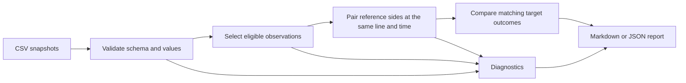

# Odds Analysis

Turn player-prop market snapshots into an explainable comparison report. Run the included synthetic example offline, with no accounts, API keys, browser setup, or runtime dependencies.

This project grew out of a Selenium/Tkinter sports-odds prototype. The remake focuses on validated inputs, reproducible analysis, and testable mathematics. [Read the redesign notes](docs/design.md).

## Try the demo

Requires Python 3.11 or newer. From the project directory:

```sh
python3 -m venv .venv
source .venv/bin/activate
python -m pip install -e .
odds-analysis examples/synthetic_quotes.csv --as-of 2030-01-15T12:05:00Z
```

On Windows, activate with `.venv\Scripts\Activate.ps1` in PowerShell. Installation may download the build tool; running the installed package requires no network access. To try it directly from source without installation:

```sh
PYTHONPATH=src python3 -m odds_analysis examples/synthetic_quotes.csv --as-of 2030-01-15T12:05:00Z
```

The synthetic fixture contains 19 rows, including intentionally bad data. It produces four target comparisons, one qualifying positive gap, and ten diagnostics. The fixed report time makes the result reproducible regardless of today's date.

| Player | Target quote | Reference probability | Target implied probability | Gap | Result |
| --- | --- | ---: | ---: | ---: | --- |
| Alex Example | Over 24.5 at +120 | 50.00% | 45.45% | +4.55 pp | `gap` |
| Alex Example | Under 24.5 at -120 | 50.00% | 54.55% | -4.55 pp | `within_threshold` |
| Blair Example | Over 45.5 at -110 | — | 52.38% | — | `different_line` |
| Drew Example | Over 52.5 at +120 | — | 45.45% | — | `no_reference` |

Read the [complete example report](examples/report.md) to see the exclusions.

## What it does

- Converts American odds to probabilities and back, removes margin proportionally from paired outcomes, and provides conditional expected-return math.
- Validates CSV records, normalizes timestamps to UTC, and distinguishes missing values from zero.
- Selects eligible pregame snapshots and handles duplicates, conflicting prices, stale observations, and incomplete reference markets explicitly.
- Compares identical event/player/market/line/side outcomes between one reference book and one target book.
- Exports deterministic Markdown or JSON, including quote timestamps and diagnostic codes in JSON.



## Use your own snapshots

```sh
odds-analysis private/quotes.csv \
  --reference-book Reference \
  --target-book Target \
  --as-of 2030-01-15T12:05:00Z \
  --max-age-minutes 15 \
  --min-gap-pp 2 \
  --format json \
  --output reports/comparison.json
```

Book names are exact after whitespace normalization. The CSV adapter accepts exactly these columns, in any order:

```csv
event_id,event_start,observed_at,sport,player,market,line,side,book,american_odds
demo-001,2030-01-15T20:00:00Z,2030-01-15T12:00:00Z,nba,Alex Example,player_points,24.5,over,Reference,-110
```

See the [schema and selection rules](docs/schema.md) before importing data. Keep local inputs under `private/` and generated reports under `reports/`; both are ignored by Git.

The original project's CSVs intentionally do not match this schema. They lack the individual reference-side snapshots needed to reconstruct an exact paired market reliably. They are not bundled or silently converted.

## How the comparison works

For positive American odds `a`, the implied probability is `100 / (a + 100)`. For negative odds it is `abs(a) / (abs(a) + 100)`.

For a complete reference pair at the same threshold and observation time:

```text
reference_over_p  = implied_over_p  / (implied_over_p + implied_under_p)
reference_under_p = implied_under_p / (implied_over_p + implied_under_p)
gap_pp = 100 × (reference_p_for_side − target_implied_p)
```

For example, a -110/-110 reference pair becomes 50%/50% after proportional margin removal. A +120 target price implies 45.45%, producing a +4.55 percentage-point gap against that reference. The default flag threshold is +2 percentage points. A nonpositive gap never receives a `gap` flag.

Reference probabilities are a modeling assumption about a market, not observed truth. A discrepancy between different thresholds is shown as `different_line`, with no probability gap. The tool does not place wagers, predict player performance, establish profitability, or implement a complete arbitrage strategy.

Version 0.1 supports pregame, positive half-integer player-prop thresholds. Integer thresholds are rejected because push probabilities are not modeled. Probabilities from a single reference book do not constitute a calibrated outcome model. Curve fitting, multiple-reference consensus, and live read-only adapters are future work.

## Develop and test

```sh
python -m unittest discover -s tests -v
python -m odds_analysis examples/synthetic_quotes.csv --as-of 2030-01-15T12:05:00Z --output reports/demo.md
```

Tests cover known mathematical results, invalid inputs, identity matching, timestamp pairing, conflict handling, age boundaries, missing data, deterministic output, CLI failures, and the complete synthetic example. GitHub Actions is configured for Python 3.11–3.14; its remote runs begin after publication.

The initial 32-test suite passed locally on Python 3.12 and 3.14. A built wheel was installed into a fresh Python 3.14 virtual environment, where the same tests and the installed command-line demo passed without network access.

The runtime uses only Python's standard library. Packaging follows the [Python Packaging User Guide](https://packaging.python.org/en/latest/guides/writing-pyproject-toml/).

## Project layout

```text
src/odds_analysis/
    adapters/csv_input.py   Strict, read-only CSV adapter
    models.py              Validated quote records and diagnostics
    odds.py                Probability, devig, and conditional return math
    comparison.py          Snapshot selection and market comparison
    reporting.py           Markdown and JSON output
    cli.py                 Command-line entry point
tests/                     Standard-library unittest suite
examples/                  Synthetic fixture and generated report
docs/                      Schema, design decisions, and project origins
```
